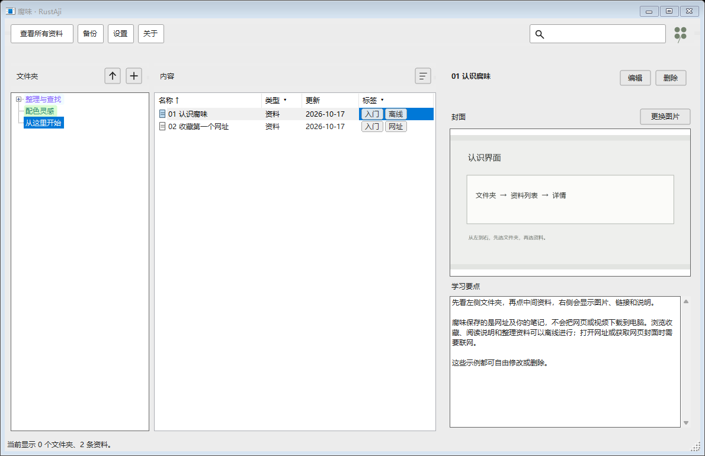

# RustAji · 腐味

[English](README_EN.md) · 简体中文

**把散落的网址、视频和学习笔记，整理成自己看得懂的本地收藏夹。**

RustAji 是一款开源、以本地资料库为中心的网址收藏工具。它适合整理课程、绘画参考、文章和长期项目资料：给链接配上文件夹、标签、自己的说明与封面，再用搜索和筛选找回来。

> **平台状态：**1.0 版是 Windows x64 桌面程序，使用 .NET 10 WinForms 编写。macOS 和 Linux 版本尚未实现。RustAji 是项目名称，不表示它由 Rust 语言编写。

## 下载与开始

在 GitHub Releases 下载 `RustAji-1.0-windows-x64.exe` 并运行。第一次打开会看到“从这里开始”“整理与查找”“配色灵感”三个示例文件夹。点开“01 认识腐味”，按右侧说明逐步操作；示例资料可以编辑、移动或删除。



完整的新手路线见 [入门教程](docs/GETTING_STARTED.md)。

## 可以做什么

- 用任意层级的文件夹整理网址，拖放调整结构。
- 给资料和文件夹添加标签，按名称、说明、标签搜索，按类型和标签筛选。
- 为资料保存笔记与图片；可尝试获取网页封面，也可以换成本机图片。
- 自定义文件夹文字、填充、图标颜色和透明度；调整全局主题、字体和装饰。
- 导出包含记录、设置和使用中图片的 `.tlb` 备份，换设备时导入。
- 修改资料保存位置，将资料库移到其他磁盘。

资料、笔记、已保存的封面与教程内容可以离线查看和整理。**打开网页链接或自动获取网页封面需要网络连接。**当前没有账户、云同步或浏览器扩展。

## 资料在哪里

默认保存于 `%LOCALAPPDATA%\腐味\`，也可在“设置 → 资料位置”中更改。程序不会把个人收藏写入源码目录。迁移或导入前建议先用“备份 → 导出完整备份”。不同电脑间可用 `.tlb` 文件传递资料。

## 从源码构建

需要 Windows 和 .NET 10 SDK。在仓库根目录运行：

```powershell
dotnet run --project Verification/Verification.csproj -c Release
dotnet publish TutorialLibrary/TutorialLibrary.csproj -c Release -o publish
```

构建结果位于 `publish/RustAji.exe`。验证程序会使用仓库内临时目录，不会读取你的正式资料库。

## 项目与许可

当前优先解决的是：个人收藏散落在浏览器、聊天记录和笔记中，后来很难按自己的学习脉络找回。我们先把 Windows 版的资料整理、检索、备份做好，再评估跨平台界面。计划见 [路线图](docs/ROADMAP.md)。欢迎提交问题与改进建议，贡献方式见 [CONTRIBUTING.md](CONTRIBUTING.md)。

源代码采用 [MIT License](LICENSE)。原始头像插画由项目作者保留权利，见 [ASSETS.md](ASSETS.md)。
